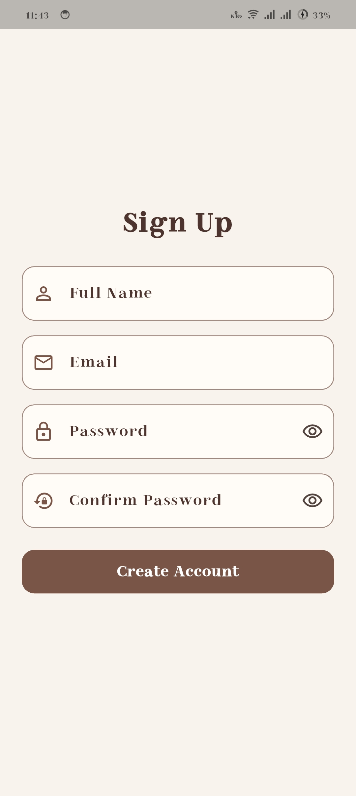

# Flutter Firebase Auth & Firestore

A Flutter mini project demonstrating how to integrate **Firebase Authentication** and **Cloud Firestore** into a Flutter application.

The app allows users to create accounts, log in securely, and save and view their own records in real time.

## ✨ Features

- 🔐 **User Authentication:** Sign up, login, and logout using Firebase Authentication.
- 📝 **Add Records:** Save a name, age, and favourite hobby.
- ☁️ **Cloud Firestore:** Store and retrieve records from the cloud.
- 🔄 **Real-Time Updates:** Display saved records using `StreamBuilder`.
- ✅ **Form Validation:** Validate user input before saving.
- 🛡️ **Data Security:** Use Firestore Security Rules to restrict record access to the authenticated owner.

## 🛠️ Technologies

- Flutter & Dart
- Firebase Authentication
- Cloud Firestore
- Material Design

## 📱 Screenshots

<p align="center">
  
  
  
  
  
</p>

## 📂 Project Structure

```text
lib/
├── screens/
│   ├── login_page.dart
│   ├── signup_page.dart
│   ├── home_page.dart
│   ├── add_record_page.dart
│   └── records_page.dart
├── services/
│   ├── auth_service.dart
│   └── firestore_service.dart
├── app_theme.dart
├── firebase_options.dart
└── main.dart
```

## 📚 What I Learned

- Integrating Firebase services into a Flutter application.
- Implementing email and password authentication.
- Performing create and read operations with Cloud Firestore.
- Displaying real-time database updates using `StreamBuilder`.
- Applying Firestore Security Rules to protect user data.
- Organizing code into screens and service classes.

## 🔒 Security Testing

Tested the application using two different accounts and confirmed that the second account could not see the first account's records through the app.

Firestore Security Rules ensure that authenticated users can access only records associated with their own user ID.

## 🚀 Getting Started

1. Clone this repository.
2. Install the dependencies:

   ```bash
   flutter pub get
   ```

3. Configure your own Firebase project for the app.
4. Enable Email/Password authentication and create a Cloud Firestore database.
5. Run the application:

   ```bash
   flutter run
   ```

### 🤎 Author

#### Habiba Fekry
